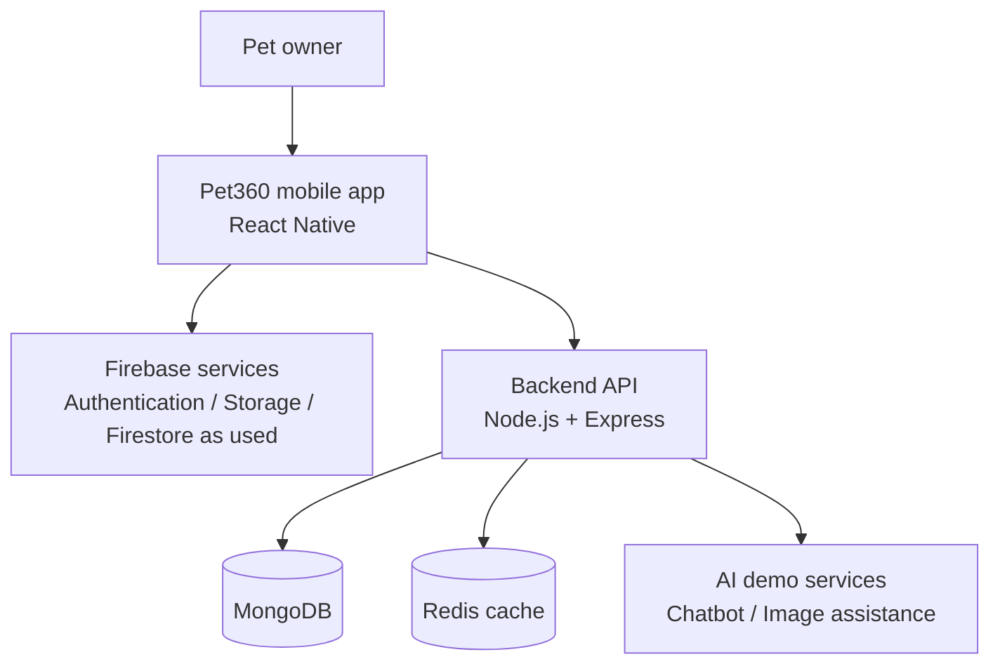

# Pet360 — Smart Pet Care Management System

<p align="center">
  <strong>Your pet, Our care.</strong><br>
  A mobile-first Final Year Project concept for connected, everyday pet care.
</p>

<p align="center">
  <a href="https://www.figma.com/design/QgoD3lbqxBHkdl1xyIPDfH/Pet360?node-id=3197-2570&t=lgG1XjkUdjsz1Miz-0">Open Figma Prototype</a> ·
  <a href="docs/PROJECT_REPORT.md">Project Report</a> ·
  <a href="docs/ARCHITECTURE.md">Architecture</a> ·
  <a href="docs/API_DESIGN.md">API Design</a>
</p>

---

## About Pet360

**Pet360** is a Smart Pet Care Management System concept designed around a React Native mobile application. Its goal is to bring pet profiles and care records, pet-related shopping, service discovery, and educational AI assistance together in one convenient experience.

This repository is intentionally a **documentation and presentation repository**. It is suitable for a public portfolio while keeping the application source code private.

> **Project status:** The interactive Figma prototype and AI demonstrations are reported as ready. Other modules and production integrations must be described as planned or in progress unless the team has verified and tested them. AI outputs are educational support only and are not a veterinary diagnosis.

## Project showcase

The images below are the screenshots provided by the project team. They are included **without editing, redesigning, recoloring, cropping, or recompressing**. The README only embeds them for presentation.

### Original screens

The complete set of uploaded screenshots is preserved in [`assets/screenshots/original-uploads/`](assets/screenshots/original-uploads/). A nested screenshot archive supplied with the upload is also preserved, with its images extracted byte-for-byte into [`assets/screenshots/nested-archive-screens/`](assets/screenshots/nested-archive-screens/).

| Preview | File |
|---|---|
| Original screenshot 1 | `assets/screenshots/original-uploads/Screenshot 2026-10-26 192847.png` |
| Original screenshot 2 | `assets/screenshots/original-uploads/Screenshot 2026-10-26 192911.png` |
| Original screenshot 3 | `assets/screenshots/original-uploads/Screenshot 2026-10-26 192930.png` |
| Original screenshot 4 | `assets/screenshots/original-uploads/Screenshot 2026-10-26 192954.png` |

To see the full collection, open the screenshots folder in GitHub. Image filenames are preserved as provided.

## Figma prototype

Explore the original design and prototype here:

**[Open Pet360 in Figma](https://www.figma.com/design/QgoD3lbqxBHkdl1xyIPDfH/Pet360?node-id=3197-2570&t=lgG1XjkUdjsz1Miz-0)**

The Figma design remains the source of truth for UI visuals. This documentation package does not modify the design, screens, colors, typography, spacing, or components.

## Goals

- Organize pet profiles and relevant care information in one place.
- Help users discover pet-care services such as veterinary appointments and grooming.
- Provide a pet-related shopping experience concept.
- Demonstrate an AI educational chatbot for general pet-care questions.
- Demonstrate image-based skin concern assistance using an uploaded or selected image.
- Present a clear, maintainable architecture for a future full implementation.

## Feature overview

| Area | Purpose | Status wording |
|---|---|---|
| Pet profile and care records | Keep pet details and care information organized | Describe only the flows implemented and verified |
| Home dashboard | Provide a central starting point for app activities | Prototype / implementation status to be verified |
| Pet shop / e-commerce | Present pet food and accessories | Planned or in progress unless verified |
| Services | Discover veterinary, grooming, caretaking, and related services | Planned or in progress unless verified |
| AI educational chatbot | Demonstrate general pet-care Q&A | AI demo reported ready; not a substitute for a veterinarian |
| Skin-image assistance | Demonstrate educational image-based guidance | AI demo reported ready; not a diagnosis |
| Authentication and data storage | Support user access and app data | Integration status to be verified |

## Technology stack

The intended / reported stack includes:

- **Mobile:** React Native
- **Backend API:** Node.js and Express
- **Authentication and cloud services:** Firebase
- **Database:** MongoDB
- **Caching:** Redis
- **AI demonstrations:** Educational chatbot and skin-image analysis demo

This list describes the project context and intended architecture; it is not a claim that every integration is already production-ready.

## High-level architecture



See [`docs/ARCHITECTURE.md`](docs/ARCHITECTURE.md) for boundaries, responsibilities, and implementation notes.

## Repository contents

```text
Pet360/
├── README.md
├── .gitignore
├── docs/
│   ├── PROJECT_REPORT.md
│   ├── ARCHITECTURE.md
│   ├── SYSTEM_FLOW.md
│   ├── DATABASE_DESIGN.md
│   ├── API_DESIGN.md
│   ├── SECURITY_AND_PRIVACY.md
│   ├── TESTING_PLAN.md
│   ├── ROADMAP.md
│   └── CONTRIBUTING.md
└── assets/
    ├── screenshots/
    │   ├── original-uploads/
    │   └── nested-archive-screens/
    └── diagrams/
```

## Team

| Role | Name |
|---|---|
| Team member | Seeman Ali |
| Team member | Sami Ullah |
| Team member / Lead Frontend Developer & Technical Documentation Specialist | Malik Moiz Ahmad Awan |
| Project supervisor | Dr Umar Shoaib |

## How to explore this repository

1. Start with this README for the project overview.
2. Open the [Figma prototype](https://www.figma.com/design/QgoD3lbqxBHkdl1xyIPDfH/Pet360?node-id=3197-2570&t=lgG1XjkUdjsz1Miz-0) to explore the design.
3. Read the [project report](docs/PROJECT_REPORT.md) for the academic summary.
4. Review the [architecture](docs/ARCHITECTURE.md), [system flow](docs/SYSTEM_FLOW.md), [database design](docs/DATABASE_DESIGN.md), and [API design](docs/API_DESIGN.md).
5. Browse `assets/screenshots/` to view the original screenshots.

## Privacy and repository scope

This public repository is for project explanation and presentation only.

- Application source code is **not included**.
- No `.env` files, API keys, passwords, private tokens, or credentials should be committed.
- Model weights and private datasets are not included.
- Screenshots should be reviewed for accidental personal data before publication.
- Do not treat this repository as an installation-ready application; it does not include the source needed to build or run the app.

## Medical / AI disclaimer

Pet360's AI features are educational demonstrations. They do not diagnose conditions, prescribe treatment, or replace a licensed veterinarian. For urgent, worsening, or concerning symptoms, users should contact a veterinary professional.

## License and ownership

No open-source license is included. Unless the project owners choose and add a license, the default copyright rules apply. Public visibility does not automatically grant permission to copy, modify, redistribute, or reuse the project materials. The team should confirm ownership and university requirements before publishing.

---

<p align="center">
  <strong>Pet360 — Your pet, Our care.</strong><br>
  Built as a student project with a focus on thoughtful pet-care experiences.
</p>
