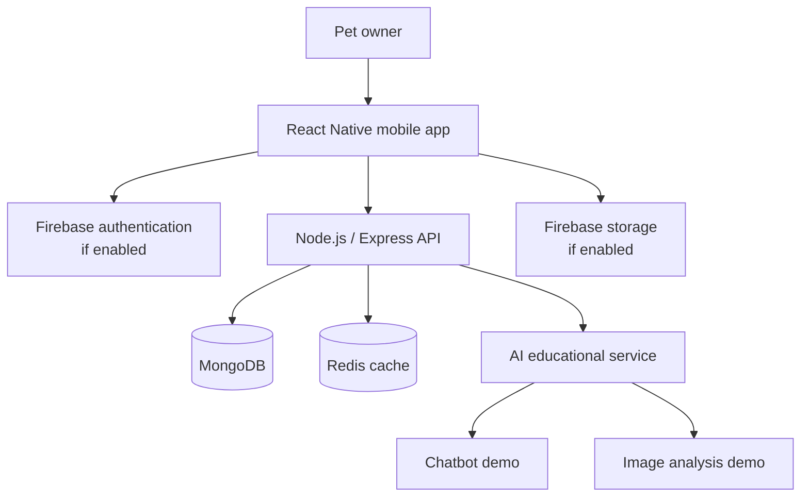

# Pet360 — System Architecture

## Architecture goals

- Keep the mobile UI separate from backend business logic.
- Define clear service boundaries.
- Protect credentials and user data.
- Treat AI features as optional educational assistance.
- Avoid coupling the app directly to database credentials.
- Document intended architecture separately from implementation status.

## Logical components

### 1. Mobile application — React Native

Responsibilities:
- Render the UI based on the approved Figma design.
- Manage navigation and client-side form state.
- Validate user input for usability.
- Request data through authorized services.
- Provide clear loading, error, and empty states.
- Make AI limitations visible near AI-generated content.

### 2. Firebase services

Firebase may be used for authentication and selected cloud services such as file storage or Firestore, depending on the actual implementation. Enable only the services the app needs and configure rules before storing real user data.

### 3. Backend API — Node.js and Express

Responsibilities:
- Validate and authorize requests.
- Apply business rules.
- Normalize errors and responses.
- Access databases through server-side credentials.
- Enforce upload size/type limits.
- Apply rate limits and logging without recording sensitive content unnecessarily.

### 4. MongoDB

Proposed role: store application entities such as user profile references, pet records, service listings, orders, and care-history entries where those records are managed by the backend.

### 5. Redis

Proposed role: short-lived caching, rate-limit counters, or temporary processing state where appropriate. Do not use Redis as the only permanent store for important user records.

### 6. AI demonstration services

The educational chatbot and image-analysis demo should be isolated behind a service boundary. Requests should be validated, errors handled safely, and the interface should state that outputs are not a veterinary diagnosis. Avoid sending unnecessary personal data to AI providers.

## Logical diagram

## Request lifecycle

1. The app gathers user input.
2. Client-side validation provides quick feedback.
3. The client sends a request over HTTPS to the appropriate service.
4. The service authenticates and authorizes the request.
5. The API validates the payload and applies business rules.
6. Data is read or written through the appropriate server-side integration.
7. The API returns a consistent response.
8. The app displays success, empty, or error state.

## Deployment model — proposed

- Mobile app: package and distribute through the team's chosen Android/iOS process.
- API: deploy to a suitable Node.js hosting service when ready.
- Database: use secured managed or self-managed MongoDB.
- Cache: use a secured Redis service only if required.
- Firebase: configure project restrictions and rules.
- Secrets: set them through hosting environment settings, never commit them.

## Architecture caveat

This document records the proposed logical architecture based on the project context. It must be reconciled with the real codebase before it is treated as an exact implementation diagram.
