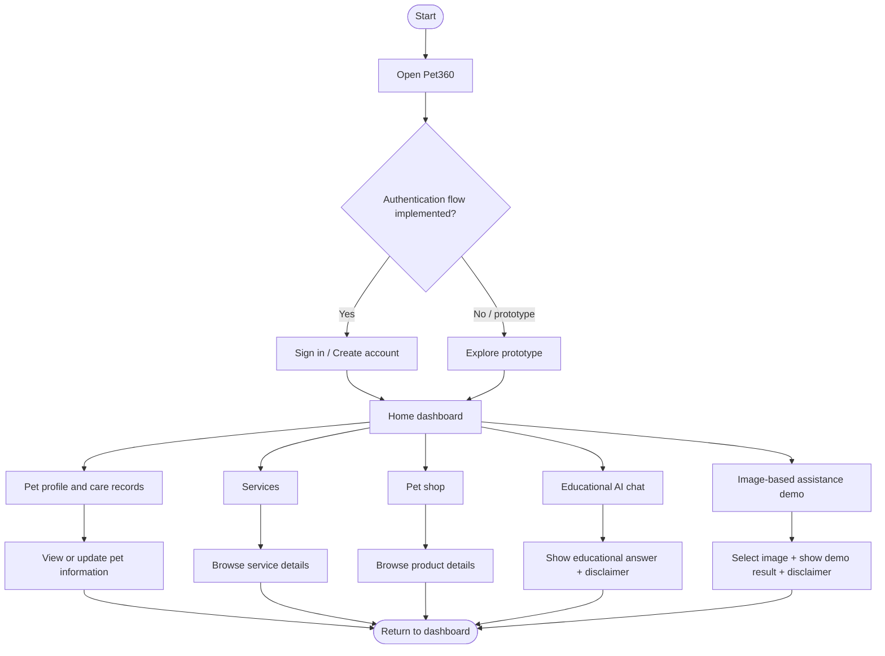

# Pet360 — System Flow

## Main user journey

## Image assistance flow

1. User opens the image-assistance screen.
2. User selects an image using the supported gallery/file picker.
3. The app validates file type and size.
4. The image is sent only to the configured analysis service if the integration is enabled.
5. The service returns an educational result or a safe error.
6. The app displays the result with a clear note that it is not a diagnosis.
7. The user is encouraged to contact a veterinarian for concerns.

## Error paths to implement

- Network unavailable.
- Authentication expired.
- Image format unsupported.
- Image too large.
- AI service timeout or rate limit.
- Empty response or malformed response.
- Permission denied.
- Backend unavailable.

## Status note

This flow describes the intended user journey. It does not imply that every step has been implemented or tested.
